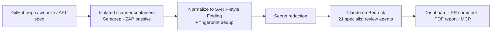

<h1 align="center">Kishor Pant</h1>
<h3 align="center">Engineering Manager · Applied AI &amp; LLM Platforms</h3>

<p align="center">
  <a href="https://techtalkbyte.xyz"></a>
  <a href="mailto:kishor@techtalkbyte.xyz"></a>
  <a href="https://linkedin.com/in/mrkishorpant"></a>
</p>

<p align="center">
  I build <b>production LLM systems that take real actions safely</b> — agentic workflows, MCP servers,
  RAG and human-in-the-loop guardrails on AWS Bedrock — while leading teams and staying hands-on in <b>Go</b> and <b>Python</b>.
</p>

<h3 align="center">Domains I've shipped in</h3>

<div align="center">
<table>
  <tr>
    <th>💼 Career</th>
    <th>🚀 Personal products</th>
  </tr>
  <tr>
    <td valign="top">
      🌐 <b>Fintech · blockchain remittance</b> — ScopeX <sub>(USDC / EURC on Stellar &amp; Polygon)</sub><br>
      💳 <b>Payments</b> — Paylo payment gateway <sub>(Immortal Technologies)</sub><br>
      🚚 <b>Logistics</b> — Shiprocket<br>
      🎮 <b>Real-money gaming</b> — QuizyGames<br>
      🛩️ <b>Drones / UAV</b> — ideaForge<br>
      🏥 <b>Health-tech</b> — Medzipp <sub>(co-founder)</sub><br>
      🤖 <b>Robotics &amp; IoT</b> — Milagrow HumanTech
    </td>
    <td valign="top">
      🛡️ <b>AI security</b> — <a href="https://openrouting.si">OpenRouting</a><br>
      <sub>SAST + secrets scanning, Claude triage, MCP server</sub><br><br>
      📈 <b>SEO / AEO analytics</b> — <a href="https://isaeo.com">isaeo</a><br>
      <sub>AI-search readiness scoring for agencies</sub>
    </td>
  </tr>
</table>
</div>

---

## 🧭 At a glance

| | |
|---|---|
| **Role** | Engineering Manager — backend, infrastructure, AI platform and delivery |
| **Experience** | 10+ years across fintech (blockchain remittance, payment gateway), logistics, real-money gaming, drones, robotics and IoT, plus a co-founder stint |
| **Focus** | Agentic AI · Model Context Protocol · RAG &amp; vector search · LLM evals · secure AI tooling |
| **Location** | Gurugram, India |

---

## 🚀 Products I've built and run

### 🛡️ [OpenRouting](https://openrouting.si) — SAST &amp; secrets scanning with AI triage that shows its work

> Proven open-source scanners find the issues; **Claude (via Amazon Bedrock)** removes false positives, explains each real issue in plain English and suggests a fix.



- **AI triage engine** — every finding gets a verdict, confidence score, explanation and patch. Findings are routed by scanner → CWE → rule keyword to one of **21 folder-driven specialist agents** (SQLi, SSRF, authz, crypto, supply chain, AI/agent security…); adding an agent is adding one Markdown file.
- **Remote MCP server** — query findings and start scans from Claude, ChatGPT or Claude Code. Built its own **OAuth 2.1 authorization server**: PKCE S256, dynamic client registration + client-ID metadata documents, rotating refresh tokens with reuse detection, per-grant rate limits, and human confirmation links for any write that hides a finding.
- **Agent-setup review** — inventories `CLAUDE.md`, `.claude/` settings, skills and MCP configs in a repo and reviews them for prompt-injection paths and over-broad tool permissions; can open a hardened setup PR.
- **Defence in depth** — scanners run with no network, non-root, read-only, all capabilities dropped; hardened git clone (no hooks/filters/submodules); SSRF guard with IP pinning for DAST; one shared redactor before every LLM call; prompt-injection-aware handling of all scanned content.
- **Platform** — PR-scoped reviews, passive DAST, API-suite analysis (Postman / OpenAPI / HAR / Insomnia / Bruno), credits ledger with refund-on-failure, Razorpay payments.

<sub><b>Stack:</b> Python 3.12 · FastAPI · Pydantic v2 · Celery + Redis · MongoDB (Beanie) · Docker SDK · Semgrep · OWASP ZAP · Anthropic SDK / AWS Bedrock · MCP · Next.js 16 + TypeScript · WeasyPrint · Nginx · Cloudflare</sub>

---

### 📈 [isaeo](https://isaeo.com) — SEO &amp; AEO analytics for agencies

> SEO asks *"will search engines rank this page?"* AEO asks *"will ChatGPT, Perplexity and Google AI Overviews **cite** it?"* isaeo scores both.

- **Full-site crawler** — follows internal links and streams results live over **Server-Sent Events**; falls back to a headless **Playwright** render for JavaScript-heavy pages.
- **AI search readiness score** — deterministic AEO analysis: JSON-LD types, FAQ / Q&amp;A blocks, answer-friendly structure, `llms.txt`, and whether GPTBot / ClaudeBot / PerplexityBot / Google-Extended are allowed in `robots.txt`.
- **Grounded AI agents** — Claude on Bedrock rewrites and prioritises fixes from facts the crawl already computed; every reply passes a **validator that drops anything not traceable to the input** — the guard against hallucination *and* prompt injection from crawled pages.
- **Keyword &amp; competitor research** — volume, difficulty, intent, CPC, competitor keywords and SERP analysis.
- **Agency workflow** — 0–100 health scoring, scheduled re-crawls, diffs between audits, white-label PDF reports, multi-tenant accounts, Razorpay billing with HMAC-verified upgrades, SES email.

<sub><b>Stack:</b> Python · Flask · MongoDB · BeautifulSoup + lxml · Playwright · AWS Bedrock (Claude) · WeasyPrint · croniter scheduler · Razorpay · Amazon SES · Docker · Gunicorn</sub>

---

## 🏢 Production AI at work

| System | What it does | Tech |
|---|---|---|
| **Agentic ops platform** (blockchain remittance fintech) | Agents monitor payout health, investigate incidents through MCP tools and execute remediation — retry, provider switch, bulk payout — behind a policy engine that requires human approval | Bedrock · MCP · DBOS durable workflows · event-sourced audit · LLM-as-judge |
| **RAG support agent** (blockchain remittance fintech) | Customer-facing answers from a curated knowledge base with per-answer confidence scoring and automatic human escalation; ops console for ingestion and session review | RAG · **Pinecone** · Bedrock · confidence scoring · escalation analytics |
| **Logistics MCP server** | 240+ platform APIs exposed as LLM-callable tools so developers and AI agents can integrate shipping directly | Go · Model Context Protocol |
| **Semantic search** (logistics) | Embedding-based vector search across logistics platform data | **Pinecone** · **pgvector** (Postgres) |

<sub>Company code lives in private repositories — happy to walk through the architecture in a conversation.</sub>

---

## 🗺️ Career path

| Company | Domain | Role | Period | Duration |
|---|---|---|---|---|
| [ScopeX Money](https://scopex.money) | Fintech — blockchain cross-border remittance (USDC / EURC on Stellar &amp; Polygon) | Engineering Manager | Jul 2026 – Present | 4 mos |
| [Shiprocket](https://shiprocket.in) | E-commerce logistics | Technical Lead | Jan 2023 – Jul 2026 | 3 yrs 7 mos |
| [QuizyGames](https://quizygames.com) | Real-money gaming | Head of Engineering | Apr 2021 – Dec 2022 | 1 yr 9 mos |
| Immortal Technologies — **Paylo** | Payment gateway | Senior Software Engineer | Jul 2019 – Oct 2020 | 1 yr 4 mos |
| [ideaForge](https://ideaforge.com) | Drones / UAV | Technical Consultant | Sep 2018 – Jul 2019 | 11 mos |
| Medzipp | Health-tech | Co-Founder | Apr 2017 – Aug 2018 | 1 yr 5 mos |
| [Milagrow HumanTech](https://milagrowhumantech.com) | Consumer robotics &amp; IoT | Software Engineer | Apr 2016 – Mar 2017 | 1 yr |

---

## 🛠️ Tech stack

**AI &amp; LLM**<br>


### Languages &amp; frameworks

| Language | Frameworks &amp; libraries | Where I've used it |
|---|---|---|
|  | gRPC · REST microservices · MCP server | Scalable services at Shiprocket &amp; ScopeX, Shiprocket MCP server, QuizyGames |
|  | FastAPI · Django · Flask · Celery · Pydantic · Anthropic SDK · Playwright | AI &amp; data engineering at Shiprocket, QuizyGames, OpenRouting, isaeo |
|  | Laravel | Shiprocket core application |
|  | Next.js · React · Vercel AI SDK | OpenRouting dashboard &amp; site, AI tooling |
|  | MySQL · PostgreSQL · pgvector | Transactional data, CDC, vector search |
|  | — | Early career |

**Data, messaging &amp; storage**<br>


**Cloud &amp; Ops**<br>


**Observability — logs &amp; APM**<br>


---

## 🧠 How I build AI systems

```text
1. Deterministic first   → scanners, crawlers and rules produce the facts
2. LLM second            → the model triages, explains and sequences — it does not invent
3. Validate the output   → schemas, tool calls and validators drop anything untraceable
4. Treat input as hostile→ redact secrets, fence untrusted content, assume prompt injection
5. Humans hold the key   → actions that move money or hide risk need explicit approval
```

---

<p align="center">
  <a href="https://techtalkbyte.xyz">techtalkbyte.xyz</a> ·
  <a href="mailto:kishor@techtalkbyte.xyz">kishor@techtalkbyte.xyz</a> ·
  <a href="https://linkedin.com/in/mrkishorpant">LinkedIn</a>
</p>
